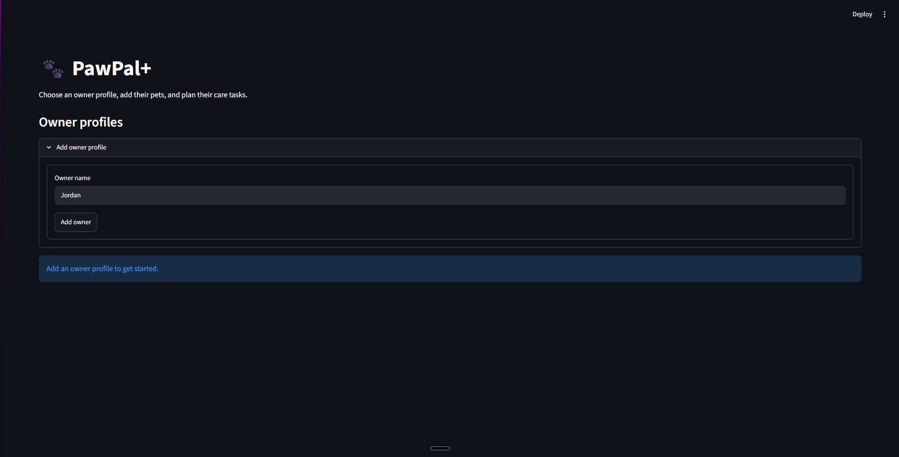
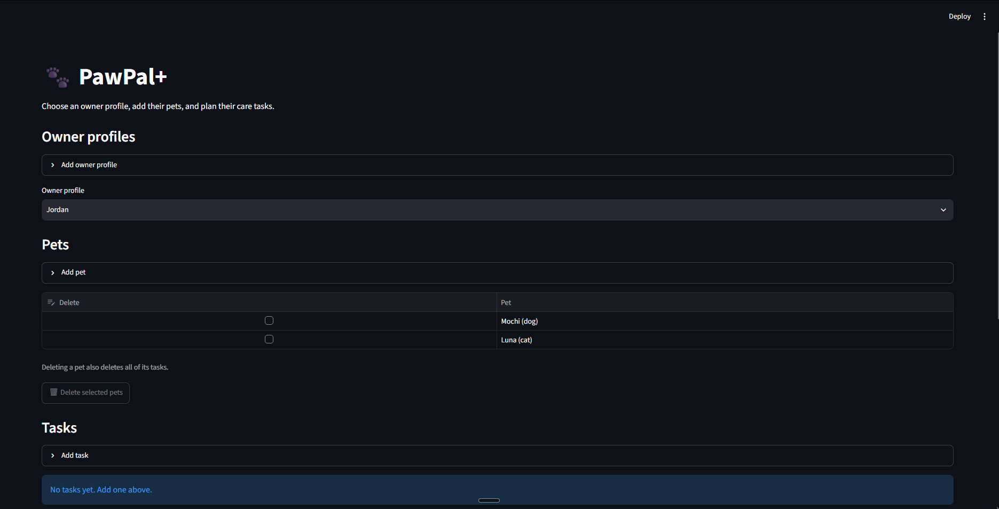
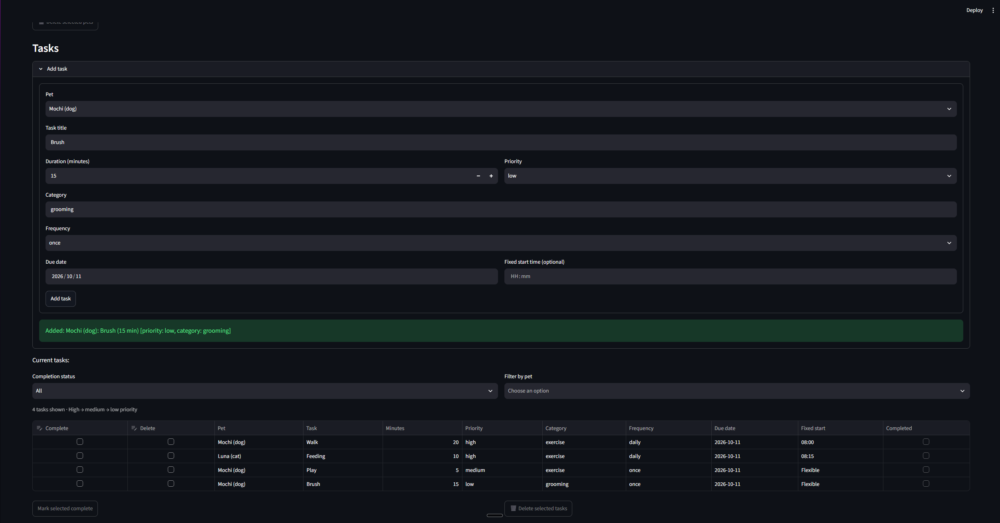
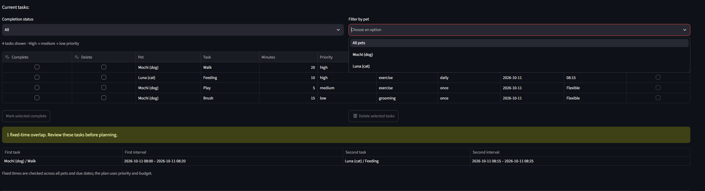
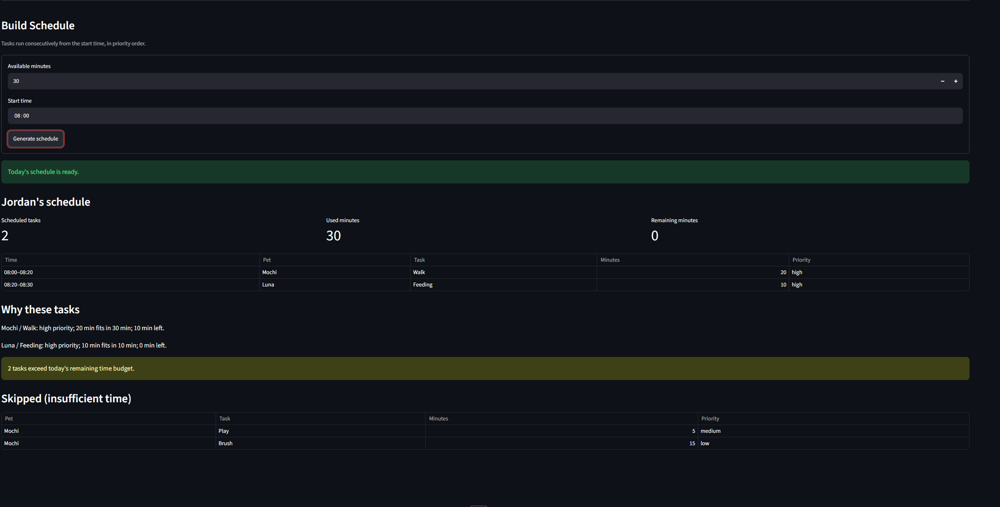

# PawPal+

Plan, track, and complete care tasks for multiple pets in Streamlit.

## Quick start

Requires Python 3.10 or newer. From the project folder, run in Windows PowerShell:

```powershell
python -m venv .venv
.\.venv\Scripts\python.exe -m pip install -r requirements.txt
.\.venv\Scripts\python.exe -m streamlit run app.py
```

Open the local URL printed in the terminal. On macOS/Linux, use `.venv/bin/python` in place of `.\.venv\Scripts\python.exe`.

## App controls

| Area | What you can do |
|---|---|
| Owner profiles | Create an owner and switch between profiles. Each has its own pets, tasks, budget, and saved inputs. |
| Pets | Add a name and species. Check **Delete**, then **Delete selected pets** to remove pets and their tasks. |
| Add task | Choose a pet; enter a title, duration, priority, category, frequency, and due date. Leave the optional fixed start time empty for flexible tasks. |
| Current tasks | View priority-sorted tasks, due dates, fixed times, and completion status. Combine **Completion status** and **Filter by pet** to narrow the list. |
| Complete tasks | Check **Complete** on pending rows, then **Mark selected complete**. Daily tasks create a new occurrence due tomorrow; one-time tasks stay completed. |
| Delete tasks | Check **Delete**, then **Delete selected tasks**. To change task details, delete the row and add the corrected task. |
| Build Schedule | Set available minutes and a start time, then **Generate schedule**. View today's slots, time totals, explanations, and skipped tasks. |

Success messages confirm actions. Warnings identify fixed-time overlaps and tasks that exceed the schedule's remaining time budget.

## Example workflow

1. Add owner **Jordan**, then pets **Mochi** and **Luna**.
2. Add today's tasks: Mochi's **Walk** (20 minutes, high, daily), Luna's **Feeding** (10 minutes, high, daily), and Mochi's **Brush** (15 minutes, low, once).
3. Set **30 available minutes**, start at **08:00**, and generate the schedule. Walk and feeding fit; brushing appears under skipped tasks.
4. Try the pet and completion filters to inspect the task list.
5. Check **Complete** on the walk and mark it complete. Its history remains visible, a new walk is due tomorrow, and today's saved plan refreshes.

To see a conflict warning, add two pending tasks on the same date with overlapping fixed times, such as a 30-minute task at 08:00 and a 10-minute task at 08:15.

## Scheduler behavior

| Behavior | What the app shows |
|---|---|
| Sorting | High → medium → low priority. Original order breaks priority ties. |
| Filtering | Status and pet filters work together. Pets with matching names remain separately selectable. |
| Due dates | Today's plan includes overdue and current pending tasks. Future and completed occurrences stay out of the plan and skipped-task table. |
| Time budget | Tasks must fit the remaining minutes. After skipping a task, the scheduler continues considering shorter tasks. |
| Recurrence | Completion retains history. Daily tasks create a pending occurrence for tomorrow; one-time tasks stay completed. Repeated completion creates no duplicates. |
| Conflict warnings | Pending fixed-time intervals are checked across all the owner's pets and due dates, including midnight crossings. Back-to-back tasks do not overlap. |

Task filters affect the task list; scheduling and conflict checks still use all of the selected owner's tasks. Fixed-time warnings are advisory: generated slots remain consecutive in priority order.

## Session data

Profiles, submitted inputs, filters, and plans survive Streamlit reruns and profile switches. Task additions, completion, and deletions refresh an existing plan using its accepted budget and start time. Schedule-form edits take effect when submitted.

Browser reloads, new visits, and app restarts start a fresh session. There is no disk or browser-storage persistence.

## Demo walkthrough

### 1. Create an owner profile

Enter **Jordan** and select **Add owner** to begin.



### 2. Add pets

Jordan's profile contains **Mochi** (dog) and **Luna** (cat). Tasks are assigned to these pets.



### 3. Add and review tasks

Set each task's duration, priority, frequency, due date, and optional fixed time. The table orders **Walk** and **Feeding** before **Play** and **Brush**, from high to low priority.



### 4. Review conflicts

Mochi's **Walk** (08:00–08:20) overlaps Luna's **Feeding** (08:15–08:25). The warning identifies both tasks and their intervals; pet-filter choices appear above the table.



### 5. Generate today's schedule

With **30 available minutes** and an **08:00** start, Walk and Feeding fill the budget. **Play** and **Brush** appear under skipped tasks, alongside explanations and time totals.



## CLI and verification

```powershell
.\.venv\Scripts\python.exe main.py
.\.venv\Scripts\python.exe main.py --algorithms
.\.venv\Scripts\python.exe -m pytest -q
```

The default CLI shows a six-task daily plan. The algorithms demo shows filtering, completion, daily successors, and cross-pet conflicts.

**Verified: 219 tests pass**, covering domain algorithms, CLI output, UI actions, profile isolation, saved plans, and date boundaries. UI actions are checked with Streamlit AppTest; table-selection tests supply the editor state sent by the browser.

Design reference: [Final UML](diagrams/uml_final.mmd).
